# Day 2 architecture: Maple Mortgage Assistant on Microsoft Foundry

**Recommendation:** one resource group (`rg-foundry-day2`) in **East US 2**, a Foundry account + project in the *basic agent setup* (no capability host, no BYO Cosmos/Storage), `gpt-4.1-mini` + `text-embedding-3-small` (GlobalStandard), Azure AI Search (Basic) for Foundry IQ, workspace-based App Insights, and ACR for the hosted agent image. Deciding trade-off: basic setup keeps cost/teardown/time low and has fewer moving parts for a workshop, at the price of Microsoft-managed (not customer-owned) thread storage, which is a production-hardening item (see ADR note below).

Reference: Azure Architecture Center / Learn "Foundry basic agent setup" and Foundry hosted agents (https://learn.microsoft.com/azure/foundry/agents/concepts/hosted-agents; https://learn.microsoft.com/azure/foundry/agents/how-to/foundry-iq-connect). Evidence base: `docs/setup-notes.md` and the recon report (researcher task t_e48c5d38, `~/Research/foundry-days-day2/sdk-recon.md`).

## Resource diagram

```mermaid
flowchart LR
  L[Learner notebook<br/>az login / DefaultAzureCredential] -->|HTTPS Responses API| P
  subgraph RG[rg-foundry-day2 - East US 2 - tag purpose=foundry-days-day2]
    subgraph ACC[Foundry account AIServices, local auth disabled]
      D1[gpt-4.1-mini<br/>GlobalStandard]
      D2[text-embedding-3-small<br/>GlobalStandard]
      P[Foundry project<br/>agents, memory stores, evals]
      C1[(Connection: KB MCP<br/>RemoteTool, ProjectMI)]
    end
    S[Azure AI Search Basic<br/>index + knowledge base]
    H[Hosted agent maple-hosted<br/>container from ACR]
    R[ACR Basic]
    AI[App Insights]
    LA[Log Analytics]
  end
  P --> D1
  P -->|memory embeddings| D2
  P -->|MCP knowledge_base_retrieve| S
  S -->|query planning| D1
  S -->|vectorize| D2
  C1 -.-> S
  R -->|image pull| H
  P --- H
  H -->|OTel traces| AI
  L -->|OTel traces| AI
  AI --- LA
  L -->|index + KB admin, Entra| S
  L -->|Learn MCP, public| M[learn.microsoft.com/api/mcp]
```

## Azure resources (Bicep, owner: system-engineer)

| Resource | Type / API version (verified live via `az provider show`) | Notes |
|---|---|---|
| Foundry account | `Microsoft.CognitiveServices/accounts@2026-11-01`, kind `AIServices`, `allowProjectManagement: true`, `disableLocalAuth: true`, SystemAssigned MI, `customSubDomainName` required | Entra only |
| Project | `accounts/projects@2026-11-01`, SystemAssigned MI | Endpoint = `AZURE_AI_PROJECT_ENDPOINT` |
| Deployments | `accounts/deployments`: `gpt-4.1-mini` (GlobalStandard, capacity 50), `text-embedding-3-small` (GlobalStandard, capacity 50) | Child type not returned by provider query: confirm with `what-if`; quota not yet checked |
| Connection | `accounts/projects/connections@2026-11-01`, `category: RemoteTool`, `authType: ProjectManagedIdentity`, target = KB MCP URL, `audience: https://search.azure.com/` | Doc example used `2025-10-01-preview`; try GA, fall back to preview |
| AI Search | `Microsoft.Search/searchServices@2025-05-01`, SKU `basic`, SystemAssigned MI, `disableLocalAuth: true`, semantic ranker on | KB/agentic retrieval itself is preview (`2026-08-01-preview` data plane) |
| App Insights | `Microsoft.Insights/components@2020-02-02` workspace-based, + `OperationalInsights/workspaces` | Connection string goes to `.env` |
| ACR | `Microsoft.ContainerRegistry/registries@2026-11-01`, Basic, admin user disabled | Image built with `az acr build` (no Docker locally) |
| Capability host | **Not deployed** (basic setup) | Only needed for standard setup (BYO Cosmos+Storage+Search) |

All tagged `purpose=foundry-days-day2`.

## RBAC (all Entra; names per current role renames, IDs unchanged)

| Principal | Scope | Role | Why |
|---|---|---|---|
| Learner / deployer user | Resource group | Foundry Project Manager (create/deploy agents) + Foundry User | Create agent versions, run evals |
| Learner user | Search | Search Service Contributor + Search Index Data Contributor | Create index, KB, upload docs (nb03) |
| Learner user | App Insights | Monitoring Reader (Log Analytics Reader) | View traces |
| Learner user | ACR | Container Registry Tasks Contributor + AcrPush (or Contributor) | `az acr build` |
| Project MI | Search | Search Index Data Reader | KB MCP calls via connection |
| Search MI | Foundry account | Cognitive Services User | KB LLM query planning + embeddings |
| Project MI | ACR | Container Registry Repository Reader | Hosted agent image pull |
| Project MI | Foundry account | Foundry User | Memory store chat/embedding models |

## Regions and model choice
- **East US 2** (recommended): hosted agents supported; `gpt-4.1`, `gpt-4.1-mini`, `gpt-5*`, embeddings available (live `az cognitiveservices model list`). Fallbacks: Sweden Central, Canada Central (both host agents; Canada lacks standard-tier gpt-5/mini, fine for us). Canada Central is the pick if the audience requires Canadian residency, at the cost of fewer model SKUs.
- **Chat: `gpt-4.1-mini`** (cheap, adequate, tool-calling, stable); judge for evals reuses it (documented upgrade: `gpt-4.1`). Embedding: `text-embedding-3-small`. Both GlobalStandard (data may be processed outside the region; fine for fictional data, flag for real FSI data: use DataZone/Standard).
- Not verified: quota in the sandbox subscription, AI Search agentic-retrieval availability in East US 2. Deploy script must run a pre-flight (`az cognitiveservices usage list`, Search availability) and report.

## Compliance flavour mapped to platform features
No keys (Entra, local auth disabled); per-customer memory `scope` (customer id) for isolation; tracing with `enable_sensitive_data=False`; audit trail = App Insights traces + Foundry agent version history; fictional data only.

## Cost and teardown
Order of magnitude per day running: Search Basic ~US$2.5/day (~US$75/mo), ACR Basic ~US$0.17/day, App Insights/Log Analytics pay-per-GB (cents at this volume), model tokens cents to a few dollars for the notebooks; hosted agent bills while running (scale to zero / delete after nb07). Prices are approximate and **unverified**; confirm in the Azure calculator. Biggest cliff: forgotten Search service and hosted agent. Teardown: `scripts/teardown.*` deletes RG `rg-foundry-day2`, then **purges** the soft-deleted Foundry account (`az cognitiveservices account purge`) so the name/quota is freed. Nothing is deleted before lead acceptance.

## 12-factor / cloud-native audit (hosted-agent service `hosted-agent/`)
| Factor | Verdict | Evidence / fix |
|---|---|---|
| I Codebase | PASS | `hosted-agent/` single codebase; same image for deploys |
| II Dependencies | PASS | pinned `requirements.txt` generated from `pyproject.toml`; container build |
| III Config | PASS | env vars only (`FOUNDRY_PROJECT_ENDPOINT`, `AZURE_AI_MODEL_DEPLOYMENT_NAME` injected by platform); no secrets |
| IV Backing services | PASS | model, search, memory via endpoints + managed identity |
| V Build/release/run | PASS | `az acr build` tag = version; `create_version` immutable agent versions; rollback = prior version |
| VI Processes | PASS | stateless; memory in Foundry memory store/session store |
| VII Port binding | PASS | `ResponsesHostServer` serves :8088 |
| VIII Concurrency | PASS (platform) | hosted agent platform scales replicas |
| IX Disposability | PASS | idempotent tools (mock), stateless restart |
| X Dev/prod parity | PASS | notebooks and hosted agent share `fsi_common` + same Foundry types |
| XI Logs | PASS | stdout + OTel to App Insights |
| XII Admin | PASS | deploy/teardown scripts, index build as a one-off script/notebook cell |
Beyond 12: managed identity PASS; API-first (Responses protocol) PASS; telemetry PASS; idempotency N/A (mock tools, read-only).

## Risks (residual)
| Risk | Sev | Mitigation | Owner |
|---|---|---|---|
| Preview features (KB MCP, memory stores, Skills API, hosting & search packages, FoundryEvals) change or are unavailable in tenant | High | Pinned versions; notebooks degrade with clear "unavailable" note, never faked | notebook owners |
| No live validation of any SDK call yet | High | Each notebook executed live after infra; smoke script `scripts/smoke` | system-engineer |
| Quota / Search region unknown | Med | Pre-flight in deploy; fallback region parameter | system-engineer |
| No Docker | Med | `create_version_from_code` primary, `az acr build` fallback | software-engineer |
| Basic setup = Microsoft-managed thread storage | Low (workshop) / High (prod) | Note in nb07: standard setup for production | architect |
| uv SSL failure | Low | pip path documented | done |
